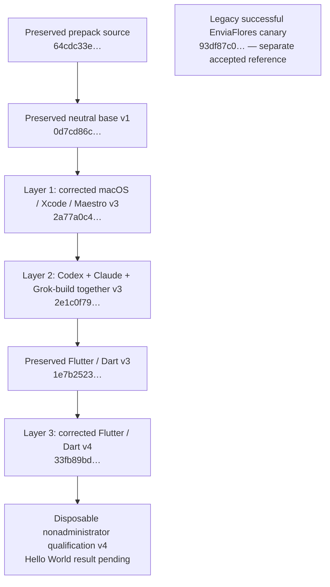

# Native image composition: measured layer chain

This records completed layer receipts through 2026-09-16T18:42:30Z. The current reusable outputs are the corrected native base v3, combined agent layer v3 and Flutter/Dart layer v4. Installed bytes, CLI launch checks, application qualification and runtime admission remain separate results.

The extra nodes show actual repair ancestry; they are not additional engine variants. All three engines share one agent layer. Credentials and personal sessions remain outside sealed images.

## Current sealed identities

| Reusable layer | Local Tart name | Native manifest SHA-256 |
| --- | --- | --- |
| macOS / Xcode / Maestro | `uxmal-macos-xcode-maestro-v3-20260916` | `2a77a0c4faed3dcbf9524d6c9238eddaa1cddce0af9b130f8f0577d76d69eceb` |
| Combined Codex / Claude / Grok-build | `uxmal-all-agents-v3-20260916` | `2e1c0f79e7b14ed43d811824507af63472885a0cbf49df86ee2071de3977227d` |
| Flutter / Dart | `uxmal-flutter-dart-v4-20260916` | `33fb89bdccd573057c11388bdf2dc243fbf8a4d5ceea46d2c577c93e2e2dd9be` |

Base v3 and agent v3 record recipe commit `24e82727c9509d406ed60d44dc71fde95e71550b`. Flutter v4 records repair source `4e41365a51b5476b3ffe717ff81624559d5d3254`. Each manifest binds its immediate physical parent, source commit and exact config/NVRAM/disk bytes; it is not an OCI manifest or executor admission.

## Native base and preserved ancestry

The original source is the preserved `rehearsal-image-v2-324e1e33062a4a3a8e7c1fa15486d07c` tuple, retained-source manifest `64cdc33e58f67d7cbd8b8a95cc39cb3b7c86e0f56134dbdf8c69b47970c67e0b`. Its component identities match the historical `232dd153…` admission and are distinct from the later accepted `93df87…` EnviaFlores canary.

Neutral base v1, manifest `0d7cd86cdff86a7f3422c858c4b0da5e1cfc426d01f05864d7b0c09786f080f8`, remains preserved. **Base v3 is a physical repair derivative of that v1 artifact**, not a newly claimed direct clone of the prepack source. The root-owned public directories `/opt/ai-runner-images` and its `bin` subdirectory are explicitly `0755`; the earlier builder umask had left them `0700` and actual nonadministrator execution returned errno 13.

The retained base tool measurements are reused for unchanged components:

| Tool | Observed version |
| --- | --- |
| macOS | 26.6.2, build 25G83 |
| Xcode | 26.5, build 17F42 |
| iOS Simulator runtime | 26.5, build 23F77, available |
| Maestro | 2.10.0 |
| Java | Temurin 17.0.20.1+1 |
| Node | 22.23.2 |
| Git | 2.50.1, Apple Git-155 |

These original measurements ran in the accountless root builder. Later nonadministrator Maestro, Python and xcrun version commands also returned zero; neither set of version commands proves an application build. The canonical Tart RPC file and its Templates/consumer provenance remain recorded in [native-base provenance](../provenance/native-base-20260916.json), together with historical source/component identities. Correcting public directory traversal did not replace that implementation.

V3 composition uses guest `/bin/sync` and `/sbin/shutdown -h now`, then verifies the retained Tart process exited zero and the VM stopped. Sealing locks the configuration, checks for disk holders and hashes the stopped tuple. The next derivative boot read back the persisted base repair and agent installation. Earlier v2 readback had lacked expected writes after `tart stop`; the exact mechanism remains unproven. Preserve its manifests and failures rather than treating stopped-state output alone as proof of normal shutdown. See [recovery procedures](recovery.md#shut-down-normally-before-sealing-a-layer) for the exact `--boot-receipt` and `--shutdown-receipt` arguments.

## Combined agent layer: installed and launched together

Agent v3's exact immediate parent is base v3, `2a77a0c4faed3dcbf9524d6c9238eddaa1cddce0af9b130f8f0577d76d69eceb`. The [agent pins](../recipes/agent-build/pins.json), SHA-256 `0f1ee7fee8928058ce88b33d3ae9546871ffec1f6cf8be398522f5d0c5aff5c3`, install all engines together:

| Engine | Pinned payload | Actual nonadministrator CLI result in qualification v3 |
| --- | --- | --- |
| Codex | 0.151.0, including `codex-code-mode-host` | `codex-cli 0.151.0`, exit 0 |
| Claude | 2.1.266 | `2.1.266 (Claude Code)`, exit 0 |
| Grok-build, executable `grok` | 1.0.24 | `grok 1.0.24 (68e414c661e3)`, exit 0 |

The full auth-free verifier reported `passed: true`; direct version diagnostics retained each command's output. This is actual nonadministrator executable compatibility, superseding the historical installation-only scope for those unchanged payloads. It does not establish managed model authentication or completion of an agent task. Flutter v4 inherits the same agent bytes; its repair touches SDK symlink modes and SDK metadata only.

[Combined-agent provenance](../provenance/combined-agents-20260916.json) preserves original pin hashes, installed file identities and the earlier layer's receipts. Earlier successful installation and later successful CLI launch remain distinct evidence.

## Flutter/Dart: bounded repair and pending application qualification

Flutter v3, manifest `1e7b252367856a95ba5f7d47d00ac9162f6761301783c9fecb4c299c353c0dcf`, was composed from agent v3. It installed Flutter **3.47.4**, revision `9584c6713b324636289d067944a46fd6b49df14b`, Dart **3.13.3**, and completed iOS precache. Its own manifest is the exact immediate parent of Flutter v4; the repair does not pretend the v4 disk was cloned directly from the agent layer.

The real nonadministrator v3 qualification found 17 root-owned SDK symlinks at `0700`. Darwin rejected `readlink(2)` with errno 13 before Flutter could finish its private SDK clone. All three agent CLIs passed in that same qualification, but Flutter/Dart did not. The original failed logs and disposable-clone cleanup are retained.

The [bounded SDK repair](../recipes/flutter-dart/repair-symlink-modes.py) ran in a new accountless v4 derivative. Before mutation it verified **29,265 regular files totaling 4,476,671,089 bytes**, exact link targets and the previous SDK metadata. It changed only the 17 symlink modes to `0555`, recorded those modes and reissued the SDK manifest/ready marker. Regular payload contents were unchanged. The repair performed no download, extraction, precache, account creation or agent authentication; it preserved both previous metadata files.

The resulting SDK identities are:

- `SDK-MANIFEST.json`: `33afd658c3253611d019727934ff4e5dc4021f9732f438ed7a2aab79b7165e4a`.
- `SDK-READY.json`: `0410e81b5c289fc11e551b62f890cef7aef4f49adcf541ba7b56204e828c70c2`.

A native UID/GID 504 regression reproduced the old link-permission failure and verified that the corrected actual launcher clones readable links and writable private regular files while preserving the root seed. Seven focused tests passed. That isolated test and the normal-shutdown v4 seal do not themselves establish a Flutter application build.

**Qualification v4 passed on 2026-09-16, 18:47:12–18:52:20 UTC.** The disposable clone of `33fb89bd…` entered the real Aqua session as nonadministrator UID 502/GID 20. The ordinary session owner verified eight tool launches, and the separate agent verifier checked all three pinned engine payloads and native CLI versions. The protected Flutter seed produced a private writable SDK/cache clone; the exact committed fixture built `tech.uxmal.runnerHelloWorld` for iOS Simulator with Xcode 26.5.

The app was installed and launched on its own iPhone 17 / iOS 26.5 simulator. Maestro 2.10.0 verified `Hello World`, `Count: 0`, the `Increment` action and `Count: 1`. JUnit reports one successful test and zero failures; command groups and simulator removal are confirmed. The qualification VM subsequently shut down with observed Tart exit zero and was deleted after verified evidence export. The original sealed tuple and production executor configuration remained unchanged. See the [qualification record](../qualification/flutter-ios-hello-world-20260916/README.md) for source, logs, JUnit, screenshots, exact manifests and cleanup.

The first v4 session shutdown attempt failed in a native account snapshot before any shutdown intent existed. A bounded snapshot succeeded; only the unconsumed shutdown was retried. The original failure and the subsequent normal exit remain recorded. No account preparation, image construction or completed app operation was repeated to conceal that result.

[Flutter provenance](../provenance/flutter-dart-20260916.json) retains earlier installation and recovery evidence; the [recipe](../recipes/flutter-dart/README.md) documents the public SDK and per-user APFS clone. Hello World qualifies neutral image mechanics, not Lastmile staging, managed engine authentication or multi-organization acceptance.

## Distribution and receipt reuse

All artifacts above are **local-only**. No OCI push, remote download/restore, executor admission or application workflow binding is claimed. Native manifests, historical admission identities, component hashes and future OCI manifests remain distinct.

Preserve the original v1/v2 and pre-repair v3 images, manifests, failures and operation receipts. Full private command archives and VM disks stay outside Git; public provenance contains sanitized identities and original receipt digests. Reuse valid results for unchanged components and perform only the changed qualification scope. Do not repeat completed clone/install/shutdown/seal operations to regenerate documentation.
