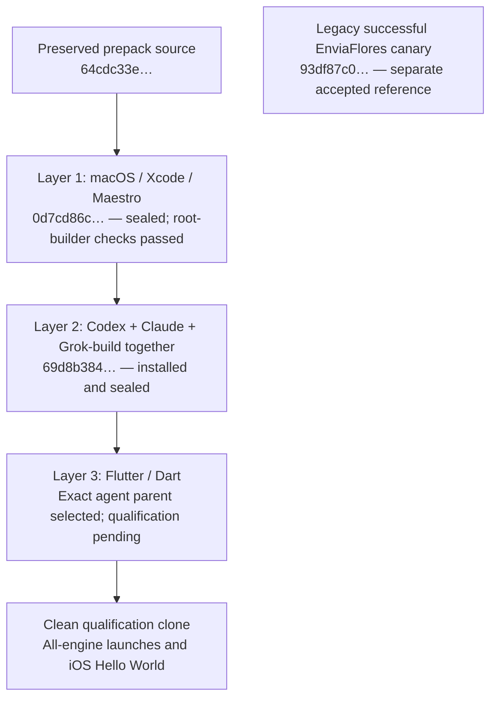

# Native image composition: measured layer chain

This records completed layer receipts through 2026-09-16T17:52:30Z. The catalog and linked provenance separate installed bytes, root-builder checks, nonadministrator qualification and runtime admission. Subsequent layer or application results must be added from their own receipts.

There is one combined agent layer. Engine installation does not include model authentication. No credential or personal session belongs in these sealed layers.

## Actual parent and first layer

The direct source is the preserved `rehearsal-image-v2-324e1e33062a4a3a8e7c1fa15486d07c` tuple. Its retained-source manifest digest is:

`64cdc33e58f67d7cbd8b8a95cc39cb3b7c86e0f56134dbdf8c69b47970c67e0b`

That tuple matches the historical `232dd153…` admission's config/NVRAM/disk identities. It is distinct from the later successful `93df87…` canary image. The retained-source manifest is a source inventory, not an OCI manifest or a new runtime admission. The original was preserved through the APFS copy-on-write clone.

The first new layer, local Tart name `uxmal-macos-xcode-maestro-20260916`, has manifest:

`0d7cd86cdff86a7f3422c858c4b0da5e1cfc426d01f05864d7b0c09786f080f8`

Recipe source: `uxmaltech-collab/ai-runner-images@53b5b31b658c4a353199a5688c8123f535846884`. Committed recipe/tool-wrapper blobs were independently compared with the local source used for this record. The neutralizer removed fixed inventoried old agent/consumer paths only in the new copy, preserved measured tool executables and recorded accountless state. That scoped inventory is not an exhaustive independent secret scan.

The canonical Tart guest RPC correction was installed as SHA-256 `a1c66855a250108ea05fc4f672f1099dfd1c315a012dee343c282aab83933952`, with Templates commit `b4164ec17ce47d0accae55d104770068bdd7f853` and consumer commit `200a9c53d34245685d738827da3b450a493a6f54` retained as source provenance. Its installation receipt says the new binary loads on the next boot; installing the file alone is not a functional RPC test.

All seven recorded tool commands returned zero in the **accountless root builder**:

| Tool | Observed result |
| --- | --- |
| macOS | 26.6.2, build 25G83 |
| Xcode | 26.5, build 17F42 |
| iOS Simulator runtime | 26.5, build 23F77, available |
| Maestro | 2.10.0 |
| Java | Temurin 17.0.20.1+1 |
| Node | 22.23.2 |
| Git | 2.50.1, Apple Git-155 |

The layer stopped before full tuple hashing and had stopped-state readback afterward. It is cataloged as `sealed-root-builder-checked`. No nonadministrator launch, simulator app build, journey, executor admission or registry publication is credited by those tool commands.

See [native-base provenance](../provenance/native-base-20260916.json) for the exact parent and output manifests, component bytes/hashes, clone and recipe chain, sanitized inventory and original receipt digests.

## Combined agent layer

The second layer cloned the exact first-layer source, preserved it and installed all engines together. Local Tart name: `uxmal-all-agents-20260916`. Manifest:

`69d8b384545966a9e88473794dbda2719f9e92a10892735f68a391723eea53d5`

Its parent manifest is exactly `0d7cd86c…`. Recipe source: `uxmaltech-collab/ai-runner-images@c6e40d034d3038f13b190da7d4eac1a58d67e4a8`. The committed [agent pins](../recipes/agent-build/pins.json) have SHA-256 `0f1ee7fee8928058ce88b33d3ae9546871ffec1f6cf8be398522f5d0c5aff5c3`.

| Engine | Installed pin | Recorded scope |
| --- | --- | --- |
| Codex | 0.151.0, including `codex-code-mode-host` | Both installed file sizes/hashes verified |
| Claude | 2.1.266 | Installed file size/hash verified |
| Grok-build, executable `grok` | 1.0.24 | Installed file size/hash verified |

The installation receipt explicitly records `binary_execution: false`, `configuration_or_credentials_created: false`, zero installation network calls and removed input staging. Versions in this table are installation pins, not successful version-command output. Nonadministrator launches and authenticated model work remain separate qualification results.

The stopped output tuple and all seven operation receipts are represented in [combined-agent provenance](../provenance/combined-agents-20260916.json). The catalog status is `sealed-installed-not-launch-qualified` until actual launch evidence changes that scope.

## Flutter layer and qualification

The Flutter/Dart derivative must use `69d8b384…` as its explicit immutable parent. Record its actual SDK/dependency pins, installation result, final manifest and source commit before presenting it as a sealed layer. Keep the two earlier images preserved for reuse and diagnosis.

Use a distinct qualification clone for the intended nonadministrator/session context and real iOS Hello World build/UI test. Record engine launch results individually, the Flutter/Dart versions, simulator app identity, assertions, logs and owned cleanup. A version command does not prove managed authentication; Hello World does not establish Lastmile staging or multi-organization acceptance.

## Distribution and receipt reuse

All artifacts above are **local-only**. No OCI push, remote download/restore, executor admission or application workflow binding is claimed. Native layer manifest hashes, historical admission hashes, individual disk/config/NVRAM hashes and future OCI manifests remain different identities.

The small original parent and layer manifests are embedded byte-exactly in their sanitized provenance records, so their digests can be independently recomputed. Full private command receipts and VM disks remain outside Git. Host addresses, network arguments, account bindings and credentials are excluded from these public-facing summaries.

Completed clone/install/stop/seal operations must not be repeated simply to regenerate documentation. Use the existing measured layer as the next parent. Reuse valid prior checks for unchanged components, and add only the real qualification evidence for the next layer's changed scope.
