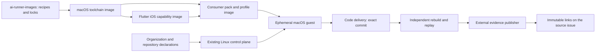

# Architecture and ownership

This is the target design. Existing owners and contracts remain authoritative until their replacements are implemented, reviewed, merged and consumed by exact pins.

## Execution and composition

An image is selected for its platform and compatible toolchain. An organization/repository binding selects its source pack, command capabilities, staging environment and evidence destination. A job supplies its exact app commit and authorized request. These are separate identities, recorded together in the execution receipt.

The new repository owns recipes, release metadata, compatibility matrices and qualification fixtures. It references source code in its current owner instead of copying private checkpoint scripts into production. The known canonical owner operations remain the execution mechanism.

| Surface | Owner |
| --- | --- |
| Native executor, guest/session/RPC protocol, installer, shared control-plane and tool validation | `uxmaltech-collab/ai-templates-resources` |
| Shared CLI/hydration and command semantics | Existing CLI/library owner; extraction or pin changes are explicit work, not an implicit fork into the image repository |
| Native recipe composition, tested toolchain combinations, image releases, image qualification history | Proposed `uxmaltech-collab/ai-runner-images` |
| Organization agent catalog, command runners, auth-account references, OIDC/GitHub App bindings and publisher policy | Each organization's resource pack/control-plane deployment |
| Flutter SDK requirement, flavor/scheme, source code, smoke and journey flows, build/environment adapter | The application repository |
| Host account IDs, APFS allocation, endpoints, service/keychain context and capacity | Installed host declaration and its existing operator |
| Runtime evidence publication and immutable byte verification | Existing external publisher with organization-scoped authority |

The exact placement of reusable journey libraries is a migration decision. Today several journey composition/driver files are consumer-owned, while the host and guest core are template-owned. Generalizing those libraries requires an upstream shared release and a deliberate consumer pin transition; the image repository should not silently claim ownership of both copies.

## Composition contract

Pin macOS base, Xcode build, Simulator runtime/build, architecture, Java/Maestro, Python and wheel closure, Node/Codex/companion, runner, Flutter revision/Dart, and any Ruby/Bundler/CocoaPods or SwiftPM tooling the app requires. Record input provenance, recipe commit, installed file/tree digests and the final image/config/NVRAM/disk identities.

The existing image owns a full immutable consumer pack at `/opt/ai-repo-resources/pack`, the offline Python/CLI tree, driver descriptor and journey execution descriptor. Reuse this supported protected-payload model for a first migration: derive consumer/profile images from a common toolchain base. Toolchain installations are reused; a pack update changes only its compatible derivative.

A single completely neutral image with per-job pack injection could reduce derivative count later, but it needs a protected, authenticated pack-staging interface and additional qualification. It is not established by the current canary. Prefer the supported derivative model for the first release.

MacOS/Xcode and Flutter versions are compatibility tuples, not independent `latest` tags. Preserve the proven Xcode/Maestro tuple as an initial candidate; select Flutter from the first application's declared constraints and then qualify it. The current native success does not certify an arbitrary Flutter version.

Tart's OCI storage is a possible distribution mechanism, not evidence that the local accepted image has already been pushed to a shared registry. The implementation must select a permitted private registry, publish the image, fetch it to a new local identity and verify the contract's image identities. Different artifact formats can have different digests: the native manifest digest is not automatically an OCI manifest digest.

## Organization and repository onboarding

Resolve a job from trusted declarations using `(organization, repository, environment, command)`. Repository prose cannot choose an arbitrary image, executable, model account or publishing identity. Each organization has its own approved application installation, resource pack, environment references and publication target.

`codex/shared` is an account reference within the approved organization deployment, not a promise to share one credential across all organizations. The control plane hydrates it only for agent work. The independent replay/test stage excludes agent credentials. Staging secrets retain their bytes and newlines and are injected as temporary files. Their values never enter image manifests, examples, Git history or public artifacts.

Use a fresh VM, checkout, simulator and work/evidence directory for each execution. Keep proprietary caches and source material scoped to their organization/repository. Shared caches may contain verified public SDK dependencies; they must not turn a tenant's mutable workspace into the next tenant's input. Retain the currently proven capacity of one native job until additional capacity has been measured and accepted. Multiple organizations do not themselves justify greater concurrency or additional host accounts.

Every new application supplies a build adapter, an environment probe, baseline smoke coverage and app-visible selectors. Its code and `.maestro/flows/` remain in its application repository. The common repository contains neutral fixtures and references, not an expanding copy of every customer's flows.

## Commands

| Capability | Current demonstrated status | Target behavior |
| --- | --- | --- |
| Resolver / `resolve` | The ordinary resolver exists; current iOS default still routes to Linux SwiftLint | Same agent, declared native profile when iOS compilation/UI work is required; analyze/build/test evidence attached to code delivery |
| `create-journey` | Real native exploration, flow delivery and independent replay passed for EnviaFlores | Same chain for any qualified native or Flutter iOS repository |
| `test-e2e` | Standalone command not found in the inspected consumer snapshot | Run selected committed smoke/journey flows at an exact commit without starting an agent; return JUnit, evidence and cleanup |

`test-e2e` must have its own authenticated existing-flow intent or a supported shared command implementation. Current final validation requires an exploration predecessor; fabricating one to reuse the function would hide an unsupported path. Reuse the runner, validator and publisher primitives while extending the command/plan contract properly.

## Continuation and truthful results

Separate operational completion, assertion outcome, delivery and publication. Optional narrative/video/export limits become warnings, with original evidence retained. Deliver code and available evidence after a functional failure so the agent can correct it and run a new bounded attempt. Preserve failed JUnit and the first diagnostic error.

Retry only identified transient reads or operations whose owner can reconcile the prior result. A lost response to a UI action, submission, commit or publication is not permission to repeat it. Reconcile the existing receipt/idempotency key first. Avoid a timeout at one layer cancelling an operation that another layer is still completing; budgets must agree across workflow, controller, guest, agent and Maestro.

This continues work without using optional evidence as a stopping condition. It does not change a failed assertion into a pass or erase the identity/provenance needed to know which app was tested. An unresolved integrity or authorization mismatch is reported with its original evidence and fixed at its owner.

Host commissioning is performed once for an accepted declaration. Image qualification is reused for identical bytes and inputs. Repository onboarding tests only the new adapter, source/env binding and functional journey. No step repeats a completed mutation merely because ownership passes between Linux and Mac or a PR description changes.
